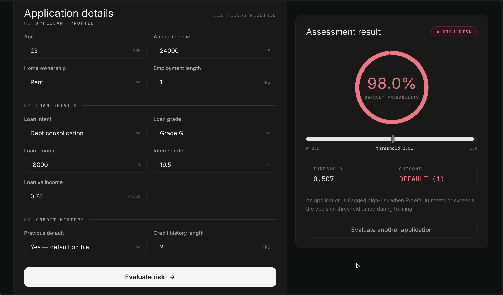
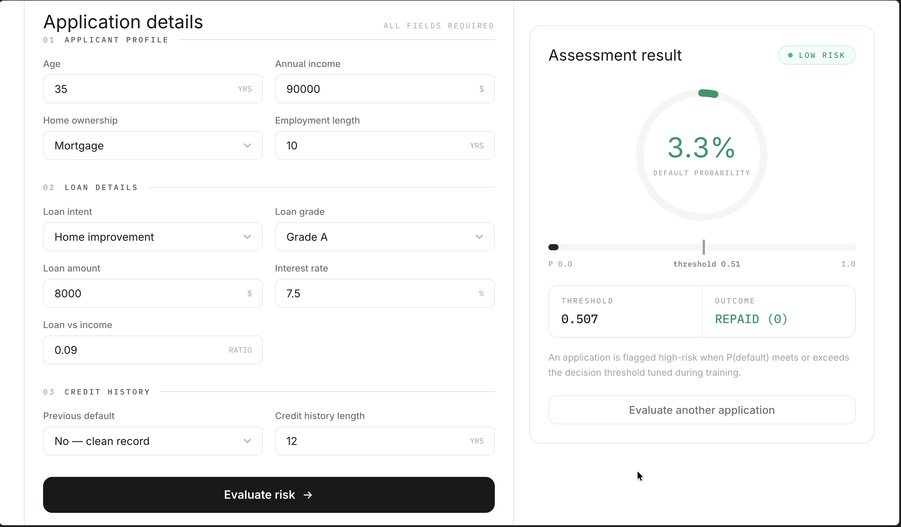
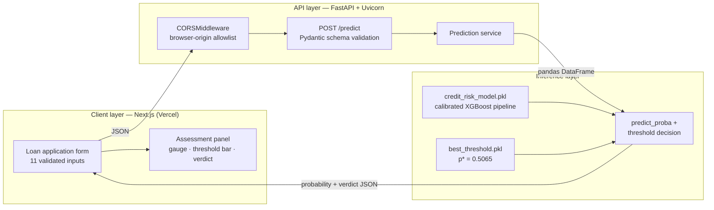
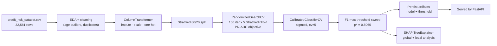

# RiskLens — Credit Risk Assessment using SHAP

End-to-end credit risk scoring system: an XGBoost loan-default classifier, hyperparameter-tuned, probability-calibrated and threshold-optimized, served as a REST API with **FastAPI**, and consumed by a minimal, animated **Next.js** frontend with dark/light mode. **SHAP** explains every prediction.


---

## Screenshots

| Dark mode — high-risk verdict | Light mode — low-risk verdict |
|:---:|:---:|
|  |  |

---

## Table of contents

1. [Overview](#overview)
2. [High-level design (HLD)](#high-level-design-hld)
3. [Dataset](#dataset)
4. [Model development](#model-development)
   - [Preprocessing](#preprocessing)
   - [Baselines](#baselines)
   - [Hyperparameter tuning](#hyperparameter-tuning)
   - [Probability calibration](#probability-calibration)
   - [Decision threshold optimization](#decision-threshold-optimization)
   - [Explainability with SHAP](#explainability-with-shap)
5. [Results](#results)
6. [FastAPI backend](#fastapi-backend)
7. [Next.js frontend](#nextjs-frontend)
8. [Getting started](#getting-started)
9. [Deployment](#deployment)
10. [Project structure](#project-structure)
11. [Roadmap](#roadmap)

---

## Overview

Lenders need to know, **before approving a loan**, how likely the applicant is to default. This project trains an XGBoost classifier on historical loan data, treats the raw model score carefully (calibration + threshold tuning rather than the default 0.5 cut-off), explains global and local behaviour with SHAP, and ships the artifact behind a typed FastAPI endpoint with an interactive single-page UI to evaluate an applicant in milliseconds.

The deployed model returns:

| Field | Meaning |
|---|---|
| `default_probability` | Calibrated P(default) in `[0, 1]` |
| `default_prediction` | `1` = high risk (default), `0` = low risk (repaid) |
| `threshold` | The F1-optimal decision threshold the model was tuned on (`0.5065`) |
| `Result` | Human-readable verdict — `High Risk` / `Low Risk` |

---

## High-level design (HLD)



**Request path, step by step:**

1. The user fills the 11-field applicant/loan form in the Next.js UI (client-side required/numeric validation).
2. `POST /predict` sends the JSON payload to FastAPI.
3. FastAPI validates types and allowed values via the `LoanApplication` Pydantic schema — malformed fields return a structured `422` with per-field messages the UI surfaces.
4. The endpoint reconstructs a single-row `pandas` DataFrame (the exact column contract used at training time) and calls `predict_proba` on the calibrated pipeline.
5. The probability is compared against the persisted optimal threshold to produce the verdict.
6. The response JSON drives an animated gauge, a probability bar with a threshold marker, and the high/low-risk badge in the UI.

**Training path (how the artifacts are produced):**



---

## Dataset

The [Kaggle Credit Risk Dataset](https://www.kaggle.com/datasets/laotse/credit-risk-dataset) (`credit_risk_dataset.csv`, 32,581 rows × 12 columns) is used for training and evaluation.

| Feature | Type | Description |
|---|---|---|
| `person_age` | int | Applicant age (years) |
| `person_income` | float | Annual income ($)
| `person_home_ownership` | str | `RENT`, `OWN`, `MORTGAGE`, `OTHER` |
| `person_emp_length` | float | Employment length (years) |
| `loan_intent` | str | `PERSONAL`, `EDUCATION`, `MEDICAL`, `VENTURE`, `HOMEIMPROVEMENT`, `DEBTCONSOLIDATION` |
| `loan_grade` | str | Risk grade `A`–`G` |
| `loan_amnt` | float | Loan amount ($) |
| `loan_int_rate` | float | Interest rate (%) |
| `loan_percent_income` | float | Loan-to-income ratio (0–1) |
| `cb_person_default_on_file` | str | Previous default — `Y` / `N` |
| `cb_person_cred_hist_length` | int | Credit history length (years) |
| **`loan_status`** | int | **Target** — `1` = default, `0` = repaid |

**Class distribution:** 25,473 repaid (78.2%) vs 7,108 defaults (21.8%) — moderately imbalanced, which matters for both tuning (PR-AUC objective) and threshold selection (F1 rather than accuracy).

Data cleaning in the notebook covers unrealistic ages (records up to 144 years), missing values in `person_emp_length` / `loan_int_rate`, and 165 duplicate rows.

---

## Model development

All modelling lives in `Credit_Risk.ipynb` and follows this logic:

### Preprocessing

- **Numeric features** — median imputation (`SimpleImputer(strategy="median")`) followed by standardization (`StandardScaler`).
- **Categorical features** — imputation followed by one-hot encoding (`OneHotEncoder`), all wired through a sklearn `ColumnTransformer` so identical transformations are applied at inference time.
- The preprocessor and classifier live in one `Pipeline`, so a single `.predict_proba()` call handles encoding + scaling + boosting, and the exact same object is persisted for serving.

### Baselines

A Logistic Regression baseline (median-imputed, standardized, one-hot encoded) establishes a reference point before boosting, giving an honest view of what XGBoost actually buys:

- LogReg: **ROC-AUC 0.8705**, F1 0.6408
- XGBoost: **ROC-AUC 0.9471**, F1 0.8073

### Hyperparameter tuning

Because the positive class (defaults) is the minority, tuning optimizes **PR-AUC (`average_precision`)** instead of accuracy or ROC-AUC — the metric most sensitive to minority-class ranking quality.

`RandomizedSearchCV` samples **150 candidates** over a 7-parameter search space, scored with **5-fold StratifiedKFold** (`scoring="average_precision"`) → **750 fits**:

| Hyperparameter | Search space |
|---|---|
| `n_estimators` | 150 – 600 |
| `max_depth` | 3 – 9 |
| `learning_rate` | 0.01 – 0.51 (uniform) |
| `subsample` | 0.6 – 1.0 (row sampling) |
| `colsample_bytree` | 0.6 – 1.0 (column sampling) |
| `min_child_weight` | 1 – 10 |
| `gamma` | 0 – 5 (pruning) |

Best cross-validated PR-AUC after tuning: **0.90**.

### Probability calibration

Raw boosted-tree outputs are excellent at *ranking* but produce over-confident, non-linearly-scalled probabilities. Since the product exposes an actual probability (a gauge, a bar, a verdict boundary), the tuned model is wrapped in `CalibratedClassifierCV(method="sigmoid", cv=5)`, which fits a logistic correction over held-out fold predictions. The notebook compares uncalibrated vs calibrated outputs with `sklearn.calibration.calibration_curve` (reliability diagrams).

Calibration matters here: it shifted the optimal cut-off from 0.4608 to **0.5065** and makes "a 72% default probability" semantically meaningful rather than just a relative score.

### Decision threshold optimization

The default 0.5 cut-off optimizes nothing in particular. Instead, the notebook sweeps the precision–recall curve on test predictions and picks the threshold maximizing F1:

```python
precisions, recalls, thresholds = precision_recall_curve(y_test, calibrated_proba)
f1_scores = 2 * (precisions * recalls) / (precisions + recalls + 1e-9)
best_threshold = thresholds[np.argmax(f1_scores[:-1])]
```

The chosen threshold — **0.5065** — is persisted as `best_threshold.pkl` and shipped next to the model so the API and the UI agree on the same boundary. Any business whose costs of a missed default differ from a rejected good loan can re-run the sweep against a custom cost function and swap the artifact.

### Explainability with SHAP

[Credit decisions must be explainable](https://shap.readthedocs.io/). The notebook applies `shap.TreeExplainer` — the exact, polynomial-time algorithm for tree ensembles — to the tuned XGBoost classifier inside the pipeline:

1. The classifier is extracted from the pipeline (`named_steps["classifier"]`).
2. Test features are transformed with the fitted `preprocessor` so SHAP operates in model-input space.
3. `preprocessor.get_feature_names_out()` maps one-hot columns back to human-readable feature names.
4. **Global analysis** — `shap.summary_plot` ranks features by mean |SHAP| value and shows how each feature pushes predictions toward default or repayment (historical defaults on file, grade, interest rate and income ratio dominate).
5. **Local analysis** — per-applicant `shap.Explanation` decomposes one decision's probability into feature contributions, i.e. exactly why *this* application was flagged.

---

## Results

Test set (6,305 records, stratified 20% hold-out):

| Model | ROC-AUC | Accuracy | Precision | Recall | F1 |
|---|---|---|---|---|---|
| Logistic Regression (optimal threshold 0.4608) | 0.88 | 0.82 | 0.56 | 0.79 | 0.65 |
| **XGBoost, tuned (optimal threshold 0.4608)** | **0.95** | **0.94** | 0.94 | 0.75 | **0.84** |

Deployed configuration — the sigmoid-calibrated pipeline with the recalibrated F1-optimal threshold **0.5065** (`best_threshold.pkl`), which re-balances precision/recall on honest probabilities before serving.

---

## FastAPI backend

`main.py` is a deliberately small, production-shaped service:

- **Lifespan-managed model loading** — both artifacts load once at startup via `contextlib.asynccontextmanager` and are cleared on shutdown, so each worker pays the deserialization cost exactly once and requests hit an in-memory model.
- **Typed request validation** — the `LoanApplication` Pydantic model enforces the full feature contract (`int`/`float` coercion, missing-field errors).
- **CORS middleware** — the Next.js UI calls the API from a different origin (browser → API), so `CORSMiddleware` is configured to allow browser requests without tripping CORS preflight failures.
- **Threshold in the loop** — the verdict is computed server-side against the exact threshold the model was optimized with, keeping ML logic in one place.

### Endpoints

| Method | Path | Purpose |
|---|---|---|
| `GET` | `/` | Health check |
| `POST` | `/predict` | Score a loan application |

**Request** (`POST /predict`) — all fields required:

```json
{
  "person_age": 32,
  "person_income": 65000,
  "person_home_ownership": "RENT",
  "person_emp_length": 4,
  "loan_intent": "PERSONAL",
  "loan_grade": "C",
  "loan_amnt": 12000,
  "loan_int_rate": 11.5,
  "loan_percent_income": 0.25,
  "cb_person_default_on_file": "N",
  "cb_person_cred_hist_length": 6
}
```

**Response:**

```json
{
  "default_probability": 0.03937979708170632,
  "default_prediction": 0,
  "threshold": 0.5065006244331733,
  "Result": "Low Risk"
}
```

**Curl:**

```bash
curl -X POST http://localhost:8000/predict \
  -H "Content-Type: application/json" \
  -d '{"person_age": 32, "person_income": 65000, "person_home_ownership": "RENT",
       "person_emp_length": 4, "loan_intent": "PERSONAL", "loan_grade": "C",
       "loan_amnt": 12000, "loan_int_rate": 11.5, "loan_percent_income": 0.25,
       "cb_person_default_on_file": "N", "cb_person_cred_hist_length": 6}'
```

---

## Next.js frontend

The `frontend/` directory is a self-contained Next.js 14 (App Router, TypeScript) app designed for one-click Vercel deployment:

- **Minimal, premium design system** — neutral ink-on-paper palette with `paper`/`surface` tokens, serif display type (Instrument Serif) + mono micro-labels (IBM Plex Mono), hairline borders; color is reserved for meaning (emerald = low risk, rose = high risk).
- **Every element themed** — full dark/light mode via `next-themes` (system default, persisted, no flash) with a sun/moon segmented toggle; native form controls follow via `color-scheme`.
- **Animation, restrained** — staggered entrance transitions, an animated SVG gauge sweeping to P(default) with a count-up number, a probability bar with a threshold tick, skeleton loaders, and crossfading result states (idle → loading → result/error).
- **Form ↔ API contract** — the form ships exactly the 11 features the Pydantic schema expects, with client-side validation and human-readable 422 error rendering.
- **Server-driven verdict** — the UI trusts the API's `Result`, never re-implementing decision logic client-side.

Environment: set `NEXT_PUBLIC_API_URL` to the backend base URL (defaults to `http://localhost:8000`). See `frontend/.env.example`.

---

## Getting started

**Prerequisites:** [uv](https://docs.astral.sh/uv/) (backend), Node.js ≥ 18.17 (frontend).

**1. Backend**

```bash
uv sync                # create .venv and install locked dependencies
uv run uvicorn main:app --port 8000
```

**2. Frontend**

```bash
cd frontend
npm install
npm run dev            # http://localhost:3000
```

**3. Regenerate artifacts** (optional) — run `Credit_Risk.ipynb` end to end to reproduce `credit_risk_model.pkl` and `best_threshold.pkl`.

---

## Deployment

- **Frontend → Vercel:** import the repo, set **Root Directory** to `frontend`, and add the env var `NEXT_PUBLIC_API_URL` pointing to the deployed backend URL. `frontend/.gitignore` already excludes build output, and Next.js static prerendering keeps the client bundle light.
- **Backend → Render / Railway / Fly.io:** start command `uv run uvicorn main:app --host 0.0.0.0 --port $PORT`; both `.pkl` artifacts must be present at runtime. Pin `allow_origins` in `main.py` to your Vercel domain instead of `*` once known.

---

## Project structure

```
.
├── Credit_Risk.ipynb            # EDA → tuning → calibration → threshold → SHAP
├── credit_risk_dataset.csv      # Kaggle credit risk dataset (32,581 rows)
├── credit_risk_model.pkl        # Calibrated XGBoost pipeline (preprocessor + model)
├── best_threshold.pkl           # F1-optimal decision threshold (0.5065)
├── main.py                      # FastAPI app: lifespan loading, /predict, CORS
├── pyproject.toml / uv.lock     # Locked Python environment (uv)
└── frontend/                    # Self-contained Next.js app (Vercel-ready)
    ├── app/                     # Layout, fonts, page, favicon
    ├── components/              # Brand + form + result card + theme providers
    ├── lib/api.ts               # Typed client for POST /predict
    └── tailwind.config.ts       # paper/surface palette tokens
```

---

## Roadmap

- Store SHAP force plots for each prediction (e.g. per-request watermark in the response).
- Fit a `GroupKFold`/time-based split once application timestamps exist, to measure drift.
- Model card + persisted evaluation report as CI artifact.
- Move threshold selection to a configurable cost matrix (FP/FN dollar weights).
- Caching + rate limiting on `/predict` for public hosting.

---

## Acknowledgments

- [Kaggle Credit Risk Dataset](https://www.kaggle.com/datasets/laotse/credit-risk-dataset)
- [FastAPI](https://fastapi.tiangolo.com/), [Next.js](https://nextjs.org/), [SHAP](https://shap.readthedocs.io/), [scikit-learn](https://scikit-learn.org/)
